

  

# Al-Mizan (الميزان) — offline point-of-sale for small shops

A complete cashier and store-management app that runs a whole shop from **one Android phone**, with **no internet and no server**. Built for small shops in Syria: Syrian pounds and US dollars in the same drawer, frequent power and internet cuts, and no budget for a PC, a barcode scanner or hosting.

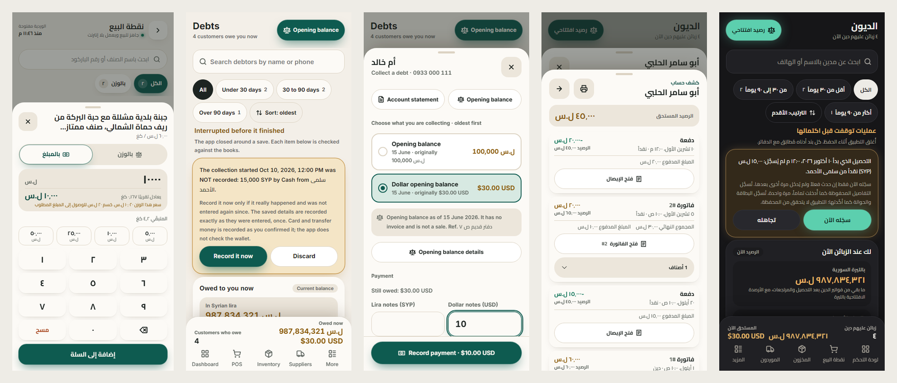

> **About this repository.** Al-Mizan is a commercial product, so the full source code lives in a private repository. This public repository shows what the app does, how it is built, and a few selected source files. I'm happy to walk through the full codebase in an interview.

---

## What it does

| Area | Features |
|---|---|
| Selling | Invoices, items sold by weight or by amount ("10,000 SYP of tomatoes"), discounts, customer credit, payment in SYP, USD or both |
| Returns | Credit notes that put stock and cash back |
| Inventory | Products, categories, stocktake, stock adjustments, low-stock warnings |
| Customers & suppliers | Account statements, debts, supplier invoices and payments |
| Cash | Shifts, cash counts, expenses, owner withdrawals, separate lira and dollar balances |
| Reports | Profit, sales and a full activity log of every money-moving action |
| Output | Receipts and statements for A4 and 80 mm thermal printers, Arabic and English |
| Safety | Backup and validated restore, device lock, commercial licensing |

Arabic-first (right-to-left) interface with English, and light and dark themes.

## Tech stack

- **React 18 + TypeScript (strict)**, Vite, Tailwind CSS
- **Dexie on IndexedDB** as the on-device database, with `useLiveQuery` so screens update themselves when data changes
- **Redux Toolkit** only for session state
- **Capacitor** to ship the same code as an Android app, plus a small custom Java plugin for printing
- **Google ML Kit** for camera barcode scanning on Android, the browser `BarcodeDetector` API on the web
- **Vitest, Testing Library, fake-indexeddb, Playwright** for testing

## How it's built: the main engineering decisions

### 1. Offline-first, one device
The project started as a classic client-server app (React → Express → Prisma → PostgreSQL). I moved it to an offline-first design because a shop must keep selling when the internet or power is down, and small shops don't want to pay for a server. All data now lives on the phone in IndexedDB.

### 2. Money is never a floating-point number
`0.1 + 0.2` is not `0.3` in JavaScript, and a shop selling by weight multiplies decimals on every line. Money is stored as integers in minor units (piastres), quantities in thousandths, and US dollars in cents, each with its own **branded type** so the compiler refuses to add lira to dollars. Prices are parsed from strings, never multiplied by 100, and every rounding step is explicit and lives in the money module. → [`code-samples/money.ts`](code-samples/money.ts)

### 3. One write path, one transaction
A sale is recorded by a single function that writes the invoice, its lines, stock, cash movement, customer debt, the daily ledger and the audit log across **11 tables in one IndexedDB transaction**. Either everything is saved or nothing is. Invoice numbers are reserved inside the same transaction, so there are never gaps.

### 4. Idempotent checkout
Every checkout carries an operation id from the first tap. A double tap, a retry or a replay after a crash saves **one** invoice, and the same id with different content is refused. A write-ahead journal lets the app recover a sale interrupted by a crash. → [`code-samples/checkoutRetry.excerpt.test.ts`](code-samples/checkoutRetry.excerpt.test.ts)

### 5. The drawer balance is derived, not stored
A stored balance can drift and you never find out why. The drawer is always computed from the daily ledger, separately for lira notes and dollar notes, and the **same function** is used to display the balance and to validate a payout. A drawer with 2,000,000 SYP and no dollar notes cannot pay out $50. → [`code-samples/drawerFold.ts`](code-samples/drawerFold.ts)

### 6. Scanning two identical items
To count two identical cans, the scanner must know when the first one left the camera. The web API reports an empty frame; ML Kit never does. The Android scanner uses a 300 ms silence timer to re-arm, attaches the listener before the camera starts so the first code isn't lost, and turns the torch off before closing the camera. → [`code-samples/nativeScanner.ts`](code-samples/nativeScanner.ts)

### 7. Platform code is isolated
Everything Android-specific sits behind small adapter files: one scanner adapter is the only file that knows the barcode plugin exists, and a `platform/` folder holds the back button, printing and files. Native plugins are loaded with dynamic imports, so the web build never downloads them, and each adapter can be mocked in tests. → [`code-samples/backButton.ts`](code-samples/backButton.ts)

### 8. Local business date
`toISOString()` is UTC, so in Syria (UTC+3) a sale made between midnight and 3 am would be filed under the previous day. The business date is always built from the phone's local calendar date.

### 9. Safe restore
Restore checks the schema version and every row against an allow-list of tables, takes a safety snapshot, then replaces all tables in one transaction. A bad file can never leave a shop half restored.

More detail in [`docs/architecture.md`](docs/architecture.md).

## Problems worth telling

- **Two cart lines, stock reduced once.** When flavour variants were added, one product could appear on two cart lines. Each line read the old stock, so the second write overwrote the first and the shelf kept stock it had already sold, silently. Fixed by summing quantities per product before checking or writing stock.
- **Three cans scanned, one charged.** ML Kit sends no empty frame, so without a fix the scanner would never re-arm and three identical cans would ring up as one, with no error. Solved with the silence timer.
- **The back button closed the app mid-sale.** Reported by the shop owner: Capacitor's Android shell finishes the app on Back by default. Fixed with a back-button listener that closes the current screen instead, guarded against a React StrictMode race. The app now exits only through a confirmed exit button.

## Testing

Around **250 test files**: unit tests for money and rounding, integration tests that run the real Dexie code on `fake-indexeddb` (including two checkouts racing with `Promise.all`), component tests, and Playwright end-to-end tests.

## My role

I built Al-Mizan with heavy use of AI coding tools (Claude Code), and I'm open about that. I chose the technology stack, defined every feature and addition, and explained the requirements to the AI. I split the work into phases, and for each phase I wrote the prompts and set the AI's role, for example as a software engineer or a domain expert. I reviewed the results and tested every build on a real phone, reporting bugs and requesting fixes until each phase was right. Most of the code was written by the AI from those instructions. I can explain why each of the decisions above was made.

## Roadmap

Planned next steps:

- **Desktop version** for a laptop at the counter, from the same React codebase.
- **Laptop and phone working together**, so both devices see the same shop data.
- **Phone as a wireless barcode scanner** for the laptop, using the camera scanner that already exists.

Today the app is deliberately single-device, so linking devices is the main design challenge: keeping data consistent between two devices without depending on the internet, and without breaking the one-transaction rule for every sale.

## Welcome and first run

A three-page introduction, then the owner sets a name and a private password before the shop opens. Arabic and English, light and dark.

  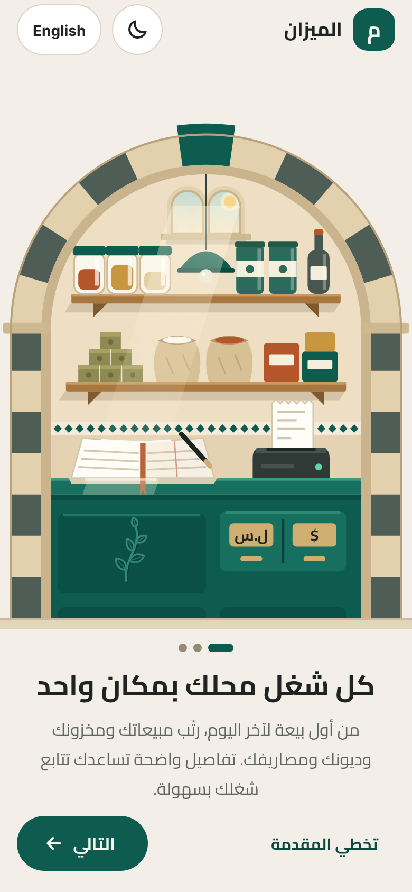
  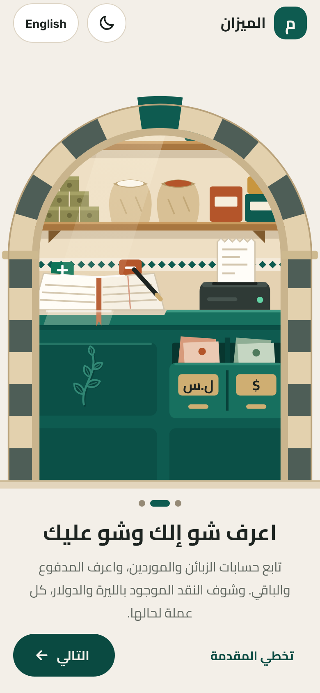
  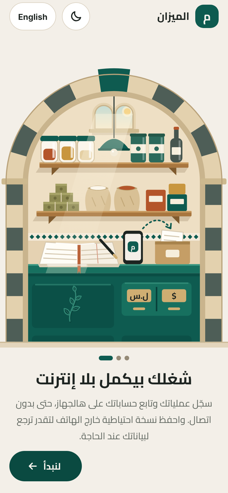
  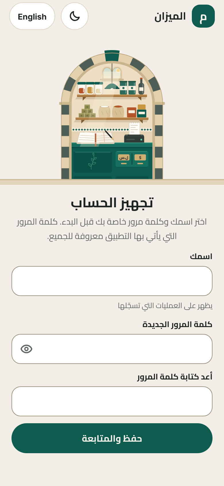

  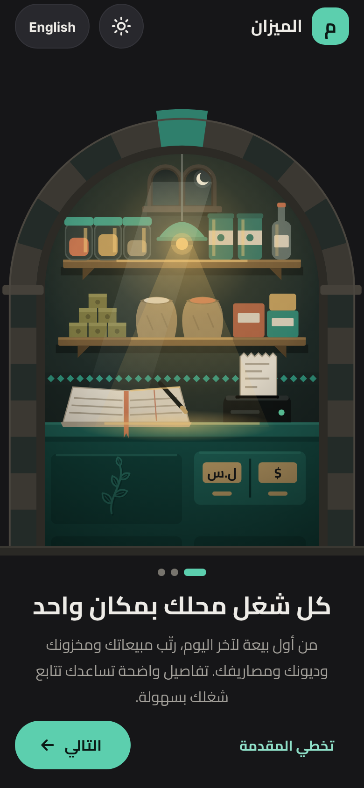
  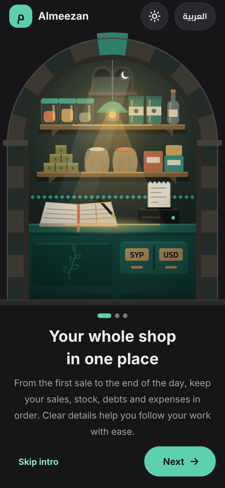

## Screens

| Selling by weight | Debts (Arabic) | Collecting in USD |
|---|---|---|
| 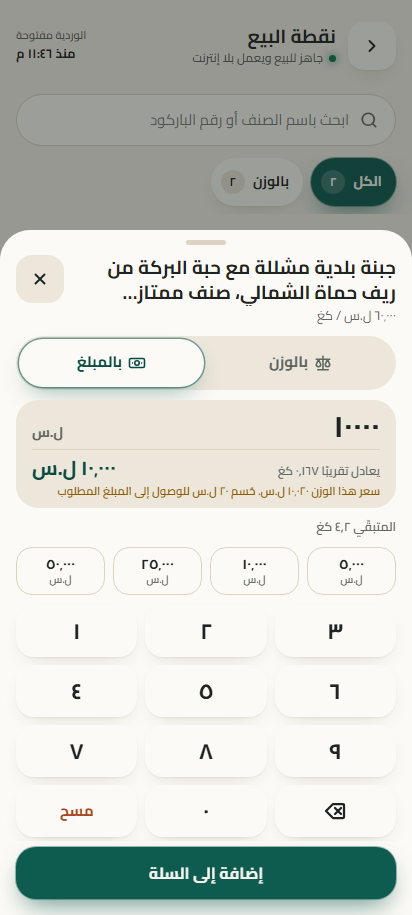 | 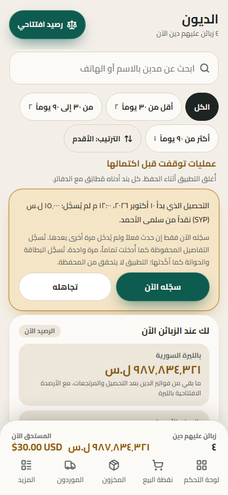 | 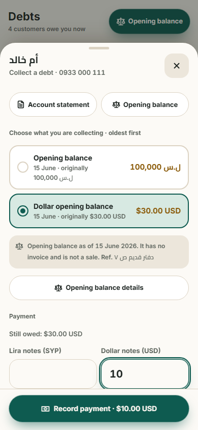 |

| Customer statement | Dark theme | Debts (English) |
|---|---|---|
| 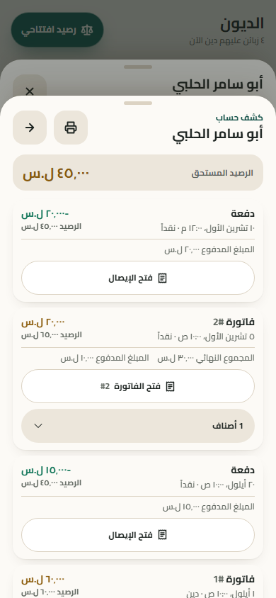 | 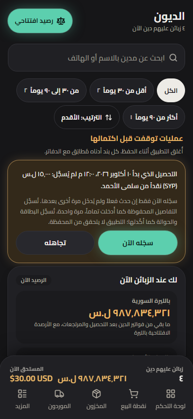 | 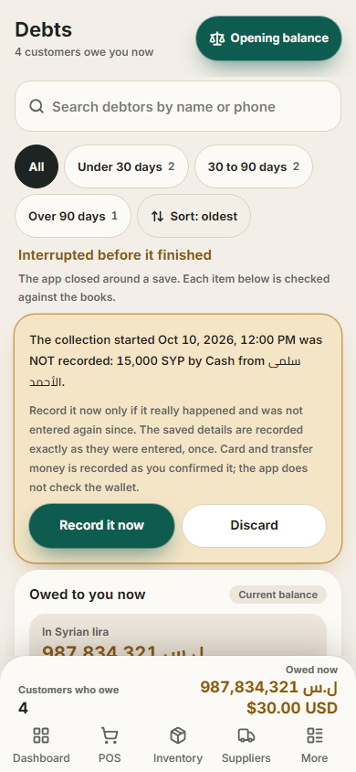 |

*Screens show sample data.*

---

**Rashad Eideh** · Informatics Engineering student, Homs University · [rashadedih20@gmail.com](mailto:rashadedih20@gmail.com)

© 2026 Rashad Eideh. All rights reserved. See [LICENSE](LICENSE).
